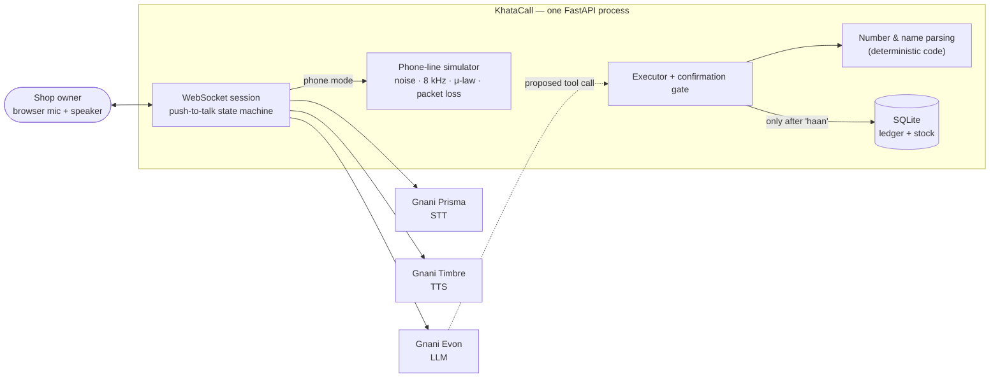

# KhataCall

**Talk to your udhaar book.** KhataCall is a voice agent that lets a kirana
shop owner record credit, payments, and stock by speaking Hinglish, even over
a noisy, low-quality phone line.

> **Owner:** "Sharma ji ka dedh sau udhaar likho."
> **KhataCall:** "Sharma ji ke khate mein ₹150 udhaar likh doon?"
> **Owner:** "Haan."
> **KhataCall:** "Likh diya. Sharma ji ka total baaki ₹1,240."

Built for Gnani AI's **Great Indian AI Internship Challenge 2026**, on Gnani's
own models end to end. It ships with an evaluation harness that measures how
the pipeline holds up on degraded telephone audio.

> **Status (Oct 6, 2026):** design stage. The architecture and plan below are
> final; the code is being built. Setup steps and results will be filled in as
> each milestone lands.

---

## Which Gnani model does what

| Stage | Model | Used for |
|---|---|---|
| Speech → text | **Prisma v2.5** | Transcribing the owner's Hinglish, including 8 kHz phone-quality audio |
| Understanding | **Evon v3.3** | Working out the intent and proposing a tool call (`add_credit`, `get_balance`, …) |
| Text → speech | **Timbre v2.5** | Speaking the confirmation and the answer back in Hinglish |

No other provider's model is used anywhere in the product.

## Architecture



**Design rules that keep the book correct:**

- **The LLM never writes to the database.** Evon *proposes* a tool call. The
  executor validates it, and nothing is written until the owner says yes.
- **Amounts are parsed by code, not by the LLM.** Evon passes the amount as
  spoken ("dedh sau"). A tested parser turns it into integer paise (15000).
  If the amount is ambiguous, the agent asks again; it never guesses.
- **The read-back is built from the exact values that will be saved.** What
  the owner approves is what gets written.
- **Money is integer paise everywhere.** No floating point.

The full design is in **[docs/HLD.md](docs/HLD.md)**: sequence diagram, state
machine, data model, Gnani API details, channel simulation, eval design, and
latency budget. The reasoning behind each choice is in
**[DECISIONS.md](DECISIONS.md)**.

## What the agent can do

| Say something like | Tool | Writes? |
|---|---|---|
| "Gupta aunty ka 2 hazaar 500 udhaar likho" | `add_credit` | yes, after confirmation |
| "Verma bhaiya ne saadhe teen sau diye" | `record_payment` | yes, after confirmation |
| "Sharma ji ka kitna baaki hai?" | `get_balance` | no |
| "Parle-G ke 20 packet aaye" | `update_stock` | yes, after confirmation |
| "Maggi kitni bachi hai?" | `get_stock` | no |
| "Kya kya khatam hone wala hai?" | `list_low_stock` | no |

The number parser handles Hindi 1–99 (irregular forms like *untees*,
*chhiyaasi*), the multipliers *sau / hazaar / lakh / crore*, fraction words
(*sava, saadhe, paune, dedh, dhai*), English words, digits, and mixes like
"2 hazaar 500".

## Evaluation: does it still work on a bad phone line?

A real kirana owner might call in from a cheap phone in a busy shop. The eval
harness replays the same recorded utterances through a simulated telephone
channel:

1. Shop background noise at a target SNR
2. Band-limiting to 300–3400 Hz and 8 kHz sampling
3. G.711 μ-law encoding
4. Bursty packet loss (Gilbert-Elliott model, 20 ms frames)

It then scores about 10 conditions, from clean audio to 5 dB SNR with 5%
packet loss.

- **Headline metric: task accuracy.** A turn counts as correct only if the
  intent, the customer, *and* the amount are all right. A wrong digit in a
  ledger is a failure even if the word error rate looks fine.
- **Also reported:**
  - character and word error rate, after normalization
  - latency from end of speech to first reply audio (p50/p90, per stage)

Measured so far (Oct 7, 5 calls per stage): speech-to-text returns a transcript
**267-367 ms** after the last word, and the first reply audio arrives about
**857 ms** after that. Choosing Gnani's streaming endpoint over its REST one
accounted for a 17x cut on the speech-to-text leg. Gnani-side load makes these
numbers swing by up to 6x between runs, so the project reports p50/p90 with
timestamps rather than a single best figure.
- The demo's "phone line mode" toggle uses the **same** degradation code, so
  what you hear in the demo is what was measured.

*Results and charts will appear here after the M3 baseline (target Oct 27)
and the M4 fixes (target Nov 1).*

## Setup

> Not runnable yet. These are the planned commands; this section will be
> confirmed once M1 lands.

```bash
uv sync                                         # install dependencies
cp .env.example .env                            # add your Gnani API key + Evon endpoint
uv run uvicorn app.main:app --reload            # open http://localhost:8000
uv run pytest -q                                # offline tests (no network)
uv run python -m eval.run_eval --dry-run        # show how many API calls an eval would make
uv run python -m eval.run_eval --max-calls 200  # run the eval with a hard cap
uv run python -m eval.report                    # build charts from results
```

**Requirements:**
- Python 3.11+ and [uv](https://docs.astral.sh/uv/)
- A Gnani API key (Prisma + Timbre)
- An Evon v3.3 endpoint, either hosted or self-served with vLLM (see
  [docs/HLD.md §7.3](docs/HLD.md))

## Data and privacy

All data is synthetic, as the contest rules require:
- Customer names are made up.
- The eval corpus is scripted sentences read aloud by the author and
  volunteers.
- Background noise is self-recorded.
- There are no real phone numbers, Aadhaar, PAN, account numbers, or recorded
  real calls anywhere in the code, data, logs, or demo.

## Known limitations

- Push-to-talk, half-duplex: you can't interrupt the agent mid-sentence.
- Prisma returns no confidence score, so the agent can't tell when it's unsure
  of what it heard. On a phone line it always reads the amount back digit by
  digit instead.
- Hinglish only for now. Prisma and Timbre support 10+ Indian languages, but
  the prompts and number parser are Hindi/English.
- The phone channel is simulated, not a real carrier network.
- One shop, one SQLite file.

## Path to production

This is a demo-grade build with a production-shaped design. Taking it to real
shops would need:

- **Real phone calls.** Connect a telephony provider (e.g. Exotel) so owners
  dial a number instead of opening a browser. The audio is already 8 kHz-ready.
  Prisma accepts 8 kHz natively, and Timbre can output G.711 μ-law directly.
- **Many concurrent calls.** Sessions are already independent. Run several
  stateless workers behind a load balancer and move session state to a shared
  store.
- **Many shops.** Per-shop tenancy on Postgres with row-level isolation, plus
  authentication by registered caller ID and a PIN.
- **Latency budgets per stage**, with alerting on p90 regressions. Switch to
  streaming STT, and keep Evon close to the telephony edge.
- **Barge-in**, so an owner can say "nahi nahi, 250" while the agent is still
  talking.
- **Audit trail**, so owners can export and dispute entries. The ledger is
  already append-only.

## Repository layout

```
app/        FastAPI server: session, Gnani adapters, agent, NLU, ledger, channel sim
eval/       corpus, channel conditions, metrics, cached runner, charts
tests/      offline unit tests (fakes only, never the network)
docs/       high-level design
```

## Acknowledgements

Built on Gnani AI's Prisma, Evon, and Timbre models for the Great Indian AI
Internship Challenge 2026.
