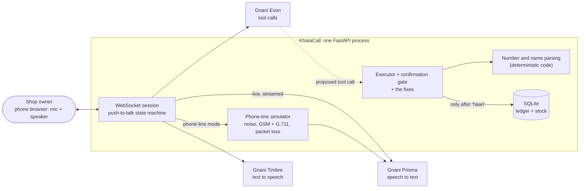
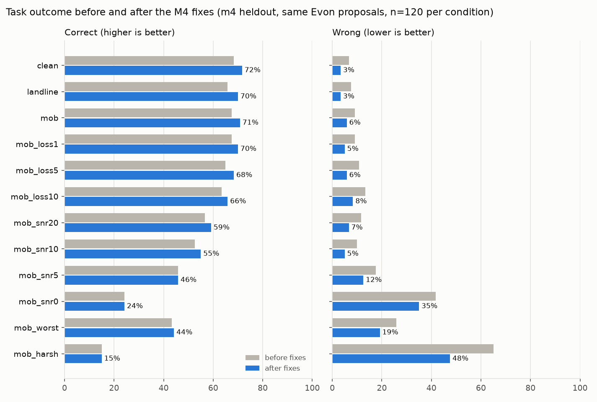
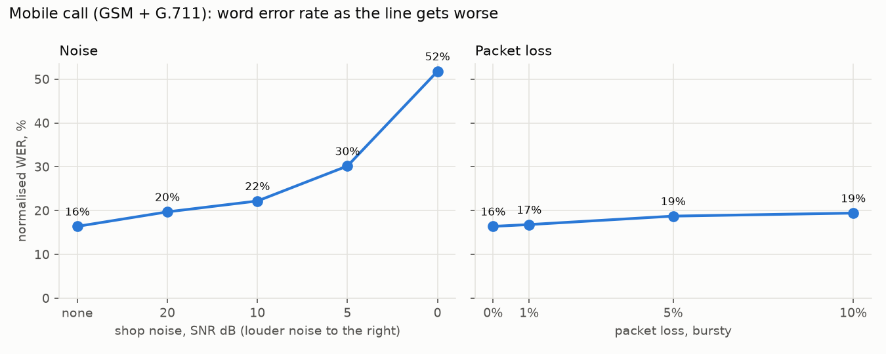

# KhataCall

**Talk to your udhaar book.** KhataCall is a voice agent that lets a kirana
shop owner record credit, payments and stock by speaking Hinglish into a
phone, and it keeps working on a noisy, low-quality line.

> **Owner:** "Sharma ji ka dedh sau udhaar likho."
> **KhataCall:** "Sharma ji ke khate mein 150 rupaye udhaar likh doon?"
> **Owner:** "Haan ji."
> **KhataCall:** "Likh diya. Sharma ji ka ab 550 rupaye baaki hai."

Built for Gnani AI's **Great Indian AI Internship Challenge 2026** on Gnani's
own models end to end, with an evaluation harness that measures how the
pipeline holds up on degraded telephone audio.

## At a glance

- **Gnani models only:** Prisma hears, Evon decides, Timbre speaks.
- **Task accuracy on held-out recordings** (intent, customer and amount all right):
  - clean audio: **71.7% correct, 3.3% wrong**; the other 25% the agent asks again;
  - a mobile call from a shop with background noise at 10 dB: **55.0% correct, 5.0% wrong**.
- **Five fixes, in deterministic code after Evon,** cut wrong answers in every
  condition: by 37-56% on a quiet line and 16-29% in heavy noise. They cost no
  correct answer on the held-out set.
- **2.03 s** from the end of speech to the first word of the reply (p50, p90 2.27 s);
  a "haan" that confirms an entry takes **0.60 s**.
- **Built for a phone.** Checked at seven screen sizes in Chrome with real touch events.
- **Rs 102** of the Rs 5,000 API credit grant spent on the whole project.
  823 offline tests.

## Which Gnani model does what

| Stage | Model | Used for | How it is called |
|---|---|---|---|
| Speech → text | **Prisma v2.5** | the owner's Hinglish, at 16 kHz or as 8 kHz phone audio | realtime WebSocket while the owner speaks; REST for phone-line mode and the eval |
| Understanding | **Evon v3.3** | working out the intent and proposing one tool call | self-hosted: 4-bit GGUF under llama.cpp on Kaggle's 2× T4, native tool calls ([docs/EVON_KAGGLE.md](docs/EVON_KAGGLE.md)) |
| Text → speech | **Timbre v2.5** | the read-back and the answer, in Hinglish (voice Poorvi, `hi-en`) | realtime WebSocket, raw PCM streamed to the browser |

No other provider's model is used anywhere in the product.

## Try it (under 5 minutes)

You need Python 3.11+, [uv](https://docs.astral.sh/uv/) and a browser. No API key is needed for this:

```bash
git clone https://github.com/diptanu2004/KhataCall.git khatacall && cd khatacall
uv sync
uv run python -m scripts.seed               # a made-up shop: 9 customers, 12 items
USE_FAKES=true uv run uvicorn app.main:app  # http://localhost:8000
```

Tap the button once to turn the microphone on, then **hold it while you speak**
and let go when you are done. The Space bar works too. With `USE_FAKES=true`
nothing leaves your machine: the speech recogniser "hears" a scripted
conversation whatever you say ("Sharma ji ka dedh sau udhaar likho", then
"haan", ...). The confirmation gate, the ledger and the UI are all real.

**With the real models:**

```bash
cp .env.example .env                        # GNANI_API_KEY, plus EVON_BASE_URL / EVON_API_KEY
uv run uvicorn app.main:app
FAKE_LLM=true uv run uvicorn app.main:app   # real Prisma and Timbre, canned Evon
```

- **Evon:** Gnani does not host Evon v3.3, so it runs on Kaggle. Follow
  [docs/EVON_KAGGLE.md](docs/EVON_KAGGLE.md); the first session takes 45-75 minutes
  and later ones about 10.
- **Shop noise for phone-line mode** is optional, and takes about 5 minutes to
  fetch: [docs/NOISE.md](docs/NOISE.md).
- **On a phone:** phones allow the microphone only over https.
  `cloudflared tunnel --url http://localhost:8000` prints an https address you can
  open on the phone; `ssh -R 80:localhost:8000 nokey@localhost.run` does the same
  with nothing to install. That address is public and has no login: anyone who
  has it can spend your credits and edit the ledger.
  [docs/DEMO.md](docs/DEMO.md) is the 60-second demo, step by step.

```bash
uv run pytest -q                            # 823 tests, no network
uv run python -m scripts.ui_check           # the page in phone-sized Chrome, real touch events
```

## What the agent can do

| Say something like | Tool | Writes? |
|---|---|---|
| "Gupta aunty ka dhai sau udhaar likho" | `add_credit` | yes, after the owner confirms |
| "Mehra ji ka bill saadhe chhe sau, paanch sau diye, baaki likh do" | `add_credit`; code reads the bill and the part paid from the words | yes: Rs 150, the rest, after the owner confirms |
| "Verma bhaiya ne saadhe teen sau diye" | `record_payment` | yes, after the owner confirms |
| "Sharma ji ka kitna baaki hai?" | `get_balance` | no |
| "Parle-G ke bees packet aaye" | `update_stock` | yes, after the owner confirms |
| "Maggi kitni bachi hai?" | `get_stock` | no |
| "Kya kya khatam hone wala hai?" | `list_low_stock` | no |

## How it keeps the book correct

A voice agent for a ledger has one job above all: never write a wrong number
with confidence. Asking again costs a few seconds; a wrong entry costs money
and the owner's trust.

- **The LLM never writes to the database.** Evon *proposes* a tool call. The
  executor validates it, and nothing is written until the owner says yes.
- **Amounts are parsed by code, not by the LLM.** Evon passes the amount as
  spoken ("dedh sau"); a parser with over 200 test cases turns it into integer
  paise (15000). It knows irregular Hindi numbers (*untees*, *chhiyaasi*),
  *sau / hazaar / lakh*, the fraction words (*sava, saadhe, paune, dedh, dhai*),
  English, digits and mixes. Anything ambiguous, such as "do teen" ("two or
  three"), is asked again, never guessed.
- **The read-back is built from the values that will be saved,** not from
  Evon's words. What the owner approves is exactly what is written.
- **Arithmetic is code too.** For a bill paid in part ("bill saadhe chhe sau,
  paanch sau diye, baaki likh do"), the code reads both amounts from the owner's
  words, subtracts, and reads back all three: "Mehra ji ka bill 650 rupaye, 500
  rupaye mile. Baaki 150 rupaye udhaar likh doon?" Evon was asked to pass the part
  paid itself and never did, in 36 tries (D-049).
- **A yes must be only a yes.** "Haan ji likh do" confirms. "Gupta ji ka do sau
  likho", said while Sharma ji's entry waits, is a new instruction, not agreement.
  A new customer is named in the read-back, so creating one is confirmed too.
- **Money is integer paise everywhere,** with database constraints to back it up.
- **On a phone line the amount is read back digit by digit** ("ek paanch shunya"),
  because Prisma gives no confidence score to decide when to.



The full design is in [docs/HLD.md](docs/HLD.md). The reasoning behind every
choice, with the numbers that settled it, is in [DECISIONS.md](DECISIONS.md)
(51 entries).

## Evaluation: does it still work on a bad phone line?

### Corpus

- **180 scripted Hinglish utterances** across the six intents: 60 credit, 45 payment,
  30 stock update, 25 balance, 12 stock check and 8 low-stock questions.
- **Every name is made up.** One speaker read all of them, and every take was checked
  for level, clipping and background noise (`scripts.check_corpus`).
- **Split before the fixes were built.** The **dev set** (60 takes) is the one whose
  failures we read in order to design the fixes. The **held-out set** (120 takes) was
  recorded afterwards and used only to measure.

### The telephone channel: 12 conditions

Each recording is played through a simulated phone call, in the order a real
call degrades it:

1. Shop noise mixed in at a target signal-to-noise ratio, measured on the active
   speech.
2. Band-limited to 300-3400 Hz and resampled to 8 kHz.
3. The codec: G.711 for a landline, or GSM 06.10 then G.711 for a mobile call.
4. Bursty packet loss on 20 ms frames.

The noise is three CC0 field recordings from Freesound: a Delhi bazaar, a
Trivandrum street market and an Indian flea market
([sources](eval/noise/SOURCES.md)).

| Condition | What it is |
|---|---|
| clean | the recording itself, 16 kHz |
| landline | G.711, 8 kHz |
| mob | mobile call: GSM 06.10 then G.711 |
| mob_loss1 / 5 / 10 | mobile call with 1%, 5% or 10% bursty packet loss |
| mob_snr20 / 10 / 5 / 0 | mobile call with shop noise at 20, 10, 5 or 0 dB |
| mob_worst | 5 dB noise and 5% loss |
| mob_harsh | 0 dB noise and 10% loss |

The demo's **phone-line mode** runs the same code on the owner's live speech,
so what you hear in the demo is what was measured. The page also shows the
eval's result for the setting you pick.

### Metrics

- **Task outcome, the headline.** Each turn is one of three:
  - **correct:** intent, customer and amount (or quantity) are all right;
  - **caught:** the agent asks again, and nothing is written;
  - **wrong:** the agent would read back a wrong value with confidence.

  It is scored with the agent's own parsing and name matching, so the eval scores
  what the agent would actually do.
- **Word and character error rate,** raw and after normalisation. Normalisation folds
  romanised spelling ("udhaar" and "udhar" are the same word) and turns number words
  into digits.

### Results: held-out set, 120 takes per condition

| Condition | WER (normalised) | Correct, before → after fixes | Wrong, before → after fixes |
|---|---|---|---|
| clean | 16.7% | 68.3% → **71.7%** | 6.7% → **3.3%** |
| landline | 17.1% | 65.8% → **70.0%** | 7.5% → **3.3%** |
| mob | 16.4% | 67.5% → **70.8%** | 9.2% → **5.8%** |
| mob_loss1 | 16.8% | 67.5% → **70.0%** | 9.2% → **5.0%** |
| mob_loss5 | 18.7% | 65.0% → **68.3%** | 10.8% → **5.8%** |
| mob_loss10 | 19.4% | 63.3% → **65.8%** | 13.3% → **8.3%** |
| mob_snr20 | 19.7% | 56.7% → **59.2%** | 11.7% → **6.7%** |
| mob_snr10 | 22.2% | 52.5% → **55.0%** | 10.0% → **5.0%** |
| mob_snr5 | 30.2% | 45.8% → **45.8%** | 17.5% → **12.5%** |
| mob_snr0 | 51.8% | 24.2% → **24.2%** | 41.7% → **35.0%** |
| mob_worst | 36.2% | 43.3% → **44.2%** | 25.8% → **19.2%** |
| mob_harsh | 65.1% | 15.0% → **15.0%** | 65.0% → **47.5%** |





**What the numbers say:**

1. **Background noise hurts; the phone line barely does.** A mobile codec with 10%
   packet loss moves WER from 16.4% to 19.4%, while noise at 0 dB moves it to 51.8%.
   Prisma handles 8 kHz phone audio well.
2. **Most of what is lost on clean audio is transcription, not reasoning.** Given
   perfect text, Evon gets 92.2% of the corpus right and 2.2% wrong (n = 180). From
   clean audio the pipeline gets 71.7%. The gap is spelling and number words: Prisma
   hears *pachchees* (25) as *pachas* (50), and writes number spellings no table can
   list in advance.
3. **The fixes buy safety more than accuracy.** Wrong answers fall in every
   condition: by 37-56% on a quiet line, and by 16-29% in heavy noise. Correct
   answers rise 2.5-4.2 points on a quiet line and barely at all in heavy noise,
   because no code can recover words the line destroyed. What the fixes do is
   refuse to act on what was not heard.
4. **The dev set flatters.** On the dev set the fixes took clean audio from 70% to
   80% correct; on the held-out set, from 68% to 72%. Part of the dev gain was fitted
   to failures we had read, which is what the split was for.

### The five fixes

All five act after Evon, in deterministic code, behind one switch. "Before" and
"after" are scored from the same cached Evon proposals, so the comparison costs
nothing to re-run and nothing else changes between the two.

| Fix | What it does | The failure that motivated it |
|---|---|---|
| 1. Payment guard | "Verma ji **ne** teen sau **diye**" is booked as a payment, even when Evon proposed credit | Evon booked about a fifth of payments as credit, which moves the balance the wrong way by twice the amount |
| 2. Number spellings | *ikkes*, *unteen* and *nao* parse as 21, 29 and 9 | spellings the real models produced that no folding reaches |
| 3. Unit quantities | "paanch kilo" and "do bori" parse as 5 and 2 | 7 of 30 stock updates were refused |
| 4. Heard check | the number Evon passes must be one the owner said | on a fragment, Evon filled in the example from its own prompt ("dedh sau") |
| 5. Name check | the customer Evon names must be one the owner said | when noise swallowed the name, Evon supplied "Sharma", also from its prompt |

A sixth was added after the eval, for the demo: a bill paid in part is read from the
owner's words (D-049). It fires on none of the 180 corpus sentences and none of the
2,160 cached transcripts, so the results above are unchanged.

### Reproducing it

The results files and charts are committed in [eval/results/](eval/results/). The
recordings are not, because they are the author's voice. To re-run the eval, record
a corpus with `uv run python -m scripts.record`, then:

```bash
uv run python -m eval.run_eval --dry-run --label m4    # planned calls and estimated rupees
uv run python -m eval.run_eval --label m4 --max-calls 2200
uv run python -m eval.report                           # charts, held-out set
uv run python -m eval.report --split dev
```

Every Prisma result is cached on disk by (audio hash, condition, model), and every
Evon proposal by (transcript, model, prompt), so a re-run spends nothing on
results it already has. The 120 held-out takes cost Rs 36 across all 12 conditions.

## Latency

Measured with all three real models (Nov 8): 30 takes replayed through the
server's WebSocket at real-time pace, each followed by a "haan" when it was a
write. Times run from the end of speech to the first byte of reply audio.

| Stage | Request (n = 30), p50 / p90 | "Haan" (n = 20), p50 / p90 |
|---|---|---|
| Prisma, after the last word | 226 / 480 ms | 216 / 218 ms |
| Evon | 1429 / 1533 ms | not called |
| Timbre, first audio | 295 / 363 ms | 337 / 416 ms |
| **Total** | **2030 / 2272 ms** | **595 / 712 ms** |

**What got it there,** each change measured before and after:

- **Prisma's realtime endpoint instead of REST.** It transcribes while the owner
  speaks, which made that leg 17× faster.
- **The yes/no to a read-back is answered in code,** so about half of all write turns
  never wait for Evon.
- **Evon's connection is kept alive and warmed** when the button is pressed.
  llama.cpp's prompt cache was already serving 1,914 of ~1,935 prompt tokens, so a
  shorter prompt would have bought nothing.
- **Timbre's socket is opened when the button is pressed.** Its occasional 2.4-3.1 s
  first chunks turned out to be slow handshakes, and hiding the handshake behind the
  owner's own speech removed them: 17 of 50 turns before, none after.
- **Two runs on Nov 5,** before and after the keep-alive and pre-open fixes:
  request p50 3.03 s → 2.35 s, p90 5.35 s → 3.20 s.

**What is left:**

- Evon is the largest stage, and about 0.4 s of it is the tunnel to Kaggle.
- Prisma's realtime endpoint occasionally stalls for about 10 s, in 1 to 3 turns of
  every 50. Prisma's own server-side latency field reports the same 10 s.

The page shows every turn's breakdown, so a slow turn is visible rather than hidden.

## Built for a phone

The owners this is for will use a phone, so the page is built for one, and
`scripts/ui_check.py` checks it in phone-sized Chrome with real touch input.

- **The mic button is docked at the bottom,** in reach of a thumb at every scroll
  position. There is no sideways scrolling from 320 px to 1280 px.
- **One tap turns the microphone on, then hold to speak.** Phones start audio only
  from a tap, never from the touch that begins a hold.
- **Sliding the finger off the button does not cut the sentence short.** A long press
  never selects text or opens a menu. The phone vibrates on press, because the finger
  covers the button.
- **A tap too short to be speech gets a hint,** and a silent hold gets "phir se
  boliye" in about 2 s, not a 15 s wait.
- **The microphone turns off when the app goes to the background.**
- **A plain http:// address explains that the microphone needs https.**
- `ui_check --real` plays a recorded take into Chrome's microphone and sends it
  through real Prisma, Evon and Timbre. It came back word for word, read back and
  committed.

## Cost

Gnani bills speech-to-text by the hour of audio and text-to-speech by the
character. The whole project, including 2,160 eval transcriptions and every
latency run, cost **Rs 102 of the Rs 5,000 grant**: Rs 62 for STT (139 minutes
of audio) and Rs 35 for TTS (13,000 characters), plus Rs 5 before metering began.
Every real call is metered locally (`uv run python -m scripts.usage`). Every
script that makes many calls prints its estimated cost with `--dry-run` and stops
at a `--max-calls` limit.

## Data and privacy

All data is synthetic, as the contest rules require:

- Every customer name is made up.
- The corpus is scripted sentences read aloud by the author.
- The background noise is public-domain street recordings.
- There are no real phone numbers, Aadhaar, PAN, account numbers or recorded real
  calls anywhere in the code, data, logs or demo.

## Known limitations

- **Push-to-talk and half-duplex.** You cannot interrupt the agent mid-sentence.
- **No confidence score from Prisma,** so the agent cannot tell when it misheard. It
  relies on the read-back, and on a phone line it spells the amount out.
- **Number spellings outside the tables are asked again,** not guessed.
  *pachahattar* (75) and *ninyanave* (99) are examples, and a list of the spellings
  seen so far does not cover them.
- **Stock items match exactly.** "lace" (Prisma's Lays) is read back as a new item,
  and the owner has to say no.
- **Name matching can be fooled by a close name.** "Sharmila" matches "Sharma ji".
  The read-back names the customer, so the owner can refuse it.
- **The corpus has one speaker,** and the held-out recordings are new takes of
  sentences whose text was already seen.
- **Evon on Kaggle is a demo setup.** Sessions end, the tunnel address changes each
  time, and the tunnel adds about 0.4 s per turn.
- **The phone UI is tested in Chrome's phone emulation, not on an iPhone,** and the
  phone channel is simulated, not a real carrier network.
- **One shop in one SQLite file, with no login.** Hinglish only.

## Path to production

KhataCall is production-shaped, not production-scaled. Taking it to real
shops would need:

- **Real phone calls.** A telephony provider's media stream (Exotel or Twilio)
  delivers 8 kHz μ-law audio. That is exactly what the channel simulator models
  and what Prisma's realtime endpoint accepts natively. Push-to-talk would give
  way to end-of-speech detection, which Prisma's VAD already reports, and then
  to barge-in, so an owner can say "nahi nahi, dhai sau" over the read-back.
- **Many concurrent calls.** Sessions are already independent per connection.
  Run several workers behind a load balancer that keeps each WebSocket on its
  worker, and move the pending confirmation and recent history to a shared store
  such as Redis. Gnani's limits set how many API keys a given call volume needs:
  20 concurrent realtime STT streams and 60 requests a minute per key, and, found
  by the eval rather than the docs, only one REST transcription at a time.
- **Per-shop tenancy on Postgres.** A shop id on every row, with row-level
  security, and the owner identified by caller ID plus a PIN. The ledger is
  already append-only, with the session that made each entry, so it doubles as
  an audit trail the owner can export and dispute.
- **Latency budgets per stage,** with alerts on p90 rather than p50: about 400 ms
  for STT after the last word, 800 ms for Evon and 400 ms for the first audio.
  The pipeline already reports every turn's breakdown.
- **Evon on a real GPU host.** vLLM in the same region as the telephony edge.
  That removes the ~0.4 s tunnel and Kaggle's session limits, and leaves only
  generation (~0.5 s) and prefill (~0.2 s).
- **Cheaper, faster replies.** Read-backs come from a small set of templates, so
  common phrases can be synthesised once and cached.
- **Better recall where it is safe:** each shop's customer and item names sent to
  Prisma as a bias list, fuzzy item matching with the same separation guard as
  customer names, and spelling matching for number words that stays close to
  exactly one value.

## Repository layout

```
app/            the server
  adapters/     Prisma, Evon and Timbre clients (all Gnani-specific code), and fakes
  pipeline/     the per-call session: push-to-talk turns, latency timing
  agent/        prompt, tool schemas, executor and confirmation gate, the six fixes
  nlu/          spoken numbers to paise, customer name matching
  ledger/       SQLite schema and repository
  channel/      the telephone channel simulation, shared by the demo and the eval
  static/       the page: one HTML file, no build step
eval/           corpus labels, conditions, metrics, cached runner, charts, results
scripts/        smoke tests, latency, UI check, recorder, seed, spend meter
deploy/         the Kaggle notebook that serves Evon
docs/           design (HLD), Evon on Kaggle, noise
tests/          823 offline tests (fakes only, never the network)
```

## Acknowledgements

Built on Gnani AI's Prisma, Evon and Timbre for the Great Indian AI Internship
Challenge 2026. Background noise from Freesound contributors alcappuccino,
soundensemble and nickcase (CC0).
