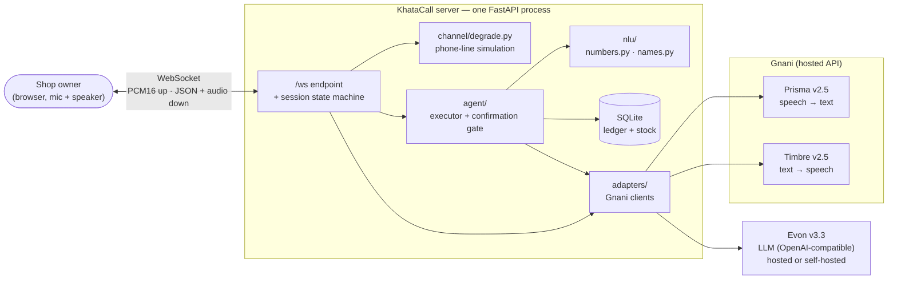
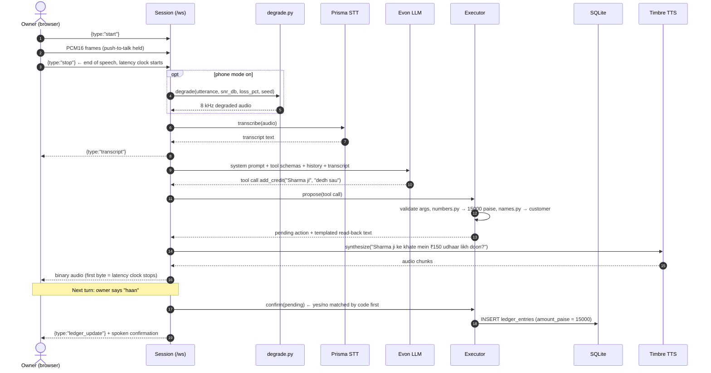
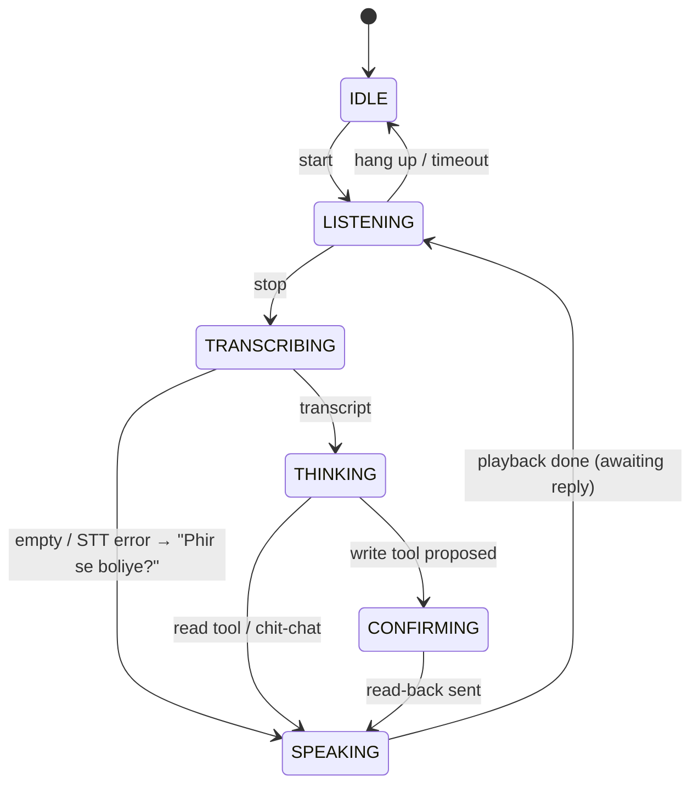
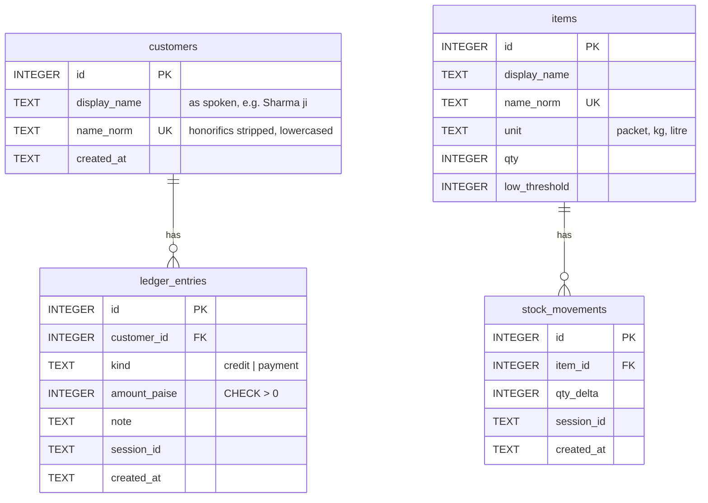
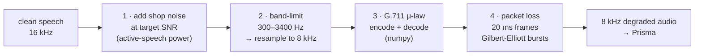
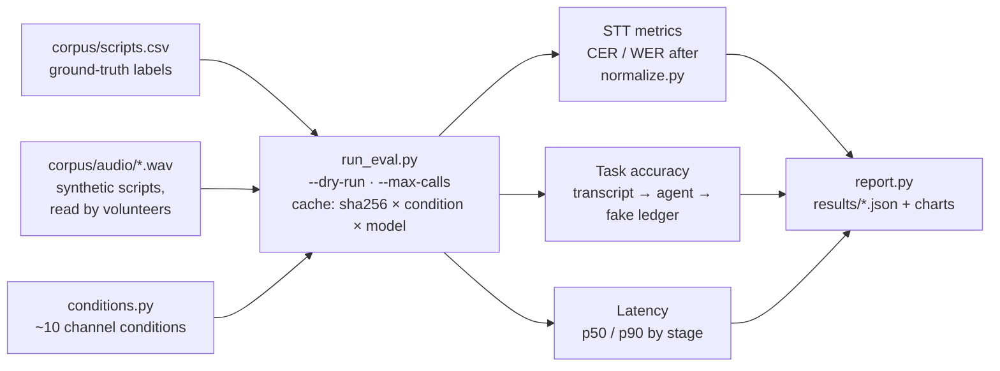

# KhataCall — High-Level Design

| | |
|---|---|
| Status | Draft v0.1, written before implementation (Oct 6, 2026) |
| Scope | Demo-grade, production-shaped. See [CLAUDE.md §1](../CLAUDE.md) |
| Decision log | [DECISIONS.md](../DECISIONS.md) |

Anything marked **VERIFY** is not confirmed in Gnani's docs and must be
checked before code depends on it.

---

## 1. Problem

A kirana shop owner keeps an udhaar (credit) book and a rough sense of stock.
Writing entries down mid-sale is slow, and the people this is for often call in
over a cheap phone or a noisy line. KhataCall lets the owner speak naturally in
Hinglish:

> "Sharma ji ka dedh sau udhaar likho."
> → "Sharma ji ke khate mein ₹150 udhaar likh doon?"
> → "Haan."
> → ledger updated.

The project has two parts that carry equal weight:

1. **The agent.** A voice loop that turns speech into correct ledger and stock
   writes, with a confirmation step before every write.
2. **The evaluation.** A measurement of how task accuracy and latency
   degrade on telephone-quality audio (narrowband, μ-law, packet loss, shop
   noise), and how much the fixes recover.

## 2. Goals and non-goals

**Goals**
- Spoken Hinglish in, spoken Hinglish out, in a browser, from one command.
- Every write is confirmed by the user before it is committed.
- Amounts are exact: integer paise, parsed by code, never by the LLM.
- Reproducible eval across about 10 channel conditions, with cached API results.
- End of speech → first reply audio under **1.5 s** (target, to be measured).

**Non-goals** (written up as prose in the README only)
Auth, multi-tenancy, Postgres, queues, container orchestration, horizontal
scaling, real phone numbers (Exotel/Twilio), admin dashboards, barge-in.

## 3. System context

The eval harness (`eval/`) reuses `channel/degrade.py`, the STT adapter, and
the agent with a throwaway ledger. The demo's phone-line mode and the
measurements therefore run the same code.

## 4. Components

| Module | Responsibility | Key constraint |
|---|---|---|
| `app/main.py` | FastAPI app, serves `static/index.html`, mounts `/ws` | One process, one command |
| `app/protocol.py` | Pydantic schemas for every WebSocket message | Single source of truth for client/server contract |
| `app/pipeline/session.py` | Per-connection state machine, stage timing | Half-duplex; one turn at a time |
| `app/adapters/base.py` | `STT`, `LLM`, `TTS` Protocols | Rest of the app depends only on these |
| `app/adapters/gnani_stt.py` | Prisma client | All Gnani specifics live in `adapters/` |
| `app/adapters/gnani_tts.py` | Timbre client | Same |
| `app/adapters/evon_llm.py` | Evon via OpenAI-compatible chat completions | Works for hosted and self-hosted |
| `app/adapters/fakes.py` | Deterministic fakes | Tests never touch the network |
| `app/agent/tools.py` | Tool JSON schemas + Pydantic arg models | Amounts arrive as `amount_spoken` text |
| `app/agent/executor.py` | Validate → parse → resolve name → pending action → commit | **Only** path that writes to the DB |
| `app/agent/prompts.py` | System prompt for a Hinglish shop assistant | |
| `app/nlu/numbers.py` | Spoken Hindi/English/mixed numbers → paise | Returns `None` when ambiguous; never guesses |
| `app/nlu/names.py` | Honorific stripping + fuzzy match (rapidfuzz) | Below threshold → ask before creating |
| `app/ledger/` | Schema, connection, repository functions | Integer paise; no floats |
| `app/channel/degrade.py` | Telephone-channel simulation | Pure, seeded, stage-by-stage testable |
| `eval/` | Corpus, conditions, metrics, cached runner, charts | `--dry-run`, `--max-calls`, disk cache |

## 5. A single turn, end to end

Three properties to point out:

- **The read-back text is generated by the executor from parsed values, not by
  the LLM.** What the owner hears is exactly what will be written.
- **Yes/no handling is deterministic first.** Code matches "haan / ha / yes /
  theek hai / kar do" and "nahi / no / cancel / mat karo". Only unclear replies
  go to Evon. This saves one LLM round trip on half of all write turns.
- **The LLM never touches the DB.** It proposes; the executor disposes.

## 6. Session state machine

A pending action lives in the session, not the DB. Its rules:
- Yes → commit.
- No → cancel.
- Unclear → re-ask once, then cancel.

A new, unrelated command while an action is pending cancels the pending
action, and the agent says so.

## 7. Gnani integration (verified against docs, Oct 6, 2026)

Base URL `https://api.vachana.ai`, auth header `X-API-Key-ID: <key>`
([docs](https://docs.gnani.ai)).

### 7.1 Prisma v2.5 (STT)

| | REST | Realtime WebSocket |
|---|---|---|
| Endpoint | `POST /stt/v3` (multipart, field `audio_file`) | `wss://api.vachana.ai/stt/v3/stream` |
| Config | form fields `language_code`, `format`, `bias_list`, … | upgrade headers `lang_code`, `x-sample-rate`, … |
| Audio | WAV/MP3/OGG/FLAC/AAC/M4A, ≤ 60 s, server converts to 16 kHz mono | PCM16 LE mono, **8000** / 16000 / 44100 / 48000 Hz, exactly 1024-byte frames, **sent at real-time cadence** |
| Output | `{success, request_id, timestamp, transcript}` | `connected`, `processing` (VAD end of segment), `transcript` (`text`, `segment_id`, `latency`), `error` |
| Confidence | **none** | **none** |

Implications for the design:

- **Hinglish → `en-IN`.** Docs: code-mixed English-Hindi is supported via
  `en-IN`. Whether Hindi words come back romanized or in Devanagari is
  **VERIFY**; `eval/normalize.py` unifies both either way.
- **No confidence score.** CLAUDE.md §5 step 5 ("low STT confidence → confirm
  digit by digit") has no signal to trigger on. Replacement: confirm digit by
  digit when phone mode is on **or** when `numbers.py` had to take a less
  certain parse path. See DECISIONS.md.
- **8 kHz is accepted natively** by the realtime API, so a phone-mode
  utterance can be sent at 8 kHz without upsampling. REST auto-converts to
  16 kHz.
- **`bias_list`** (up to 100 words) can boost known customer names and item
  names. It's a cheap fix to test in M4.
- **Realtime pacing.** The realtime API rejects buffered bursts. That makes it
  slow for bulk eval (wall-clock time = audio length), and it is the reason for
  the REST-first choice below.

**Choice for M1:** buffer the push-to-talk utterance and call **REST** on
release. Reasons:
- Utterances are 2–6 s.
- The streaming API only finalizes after its VAD sees silence anyway.
- Eval and live then share one code path.

In M4, measure whether the realtime API reduces STT latency and switch if it
does. (DECISIONS.md D-003.)

### 7.2 Timbre v2.5 (TTS)

| | Realtime WebSocket (chosen) | SSE |
|---|---|---|
| Endpoint | `wss://api.vachana.ai/api/v1/tts` | `POST /api/v1/tts/sse` |
| Request | `{text, voice, model:"timbre-v2.5", language, speed, audio_config}` | same body |
| Output | JSON `{"type":"audio","data":{chunk_index, audio:<base64>, is_final}}` then `complete` | SSE `start` / `chunk` / `complete` |

- `language: "hi-en"` exists for Hinglish (**VERIFY** quality vs `hi-IN`).
- Request `encoding: "linear_pcm"`, `container: "raw"` (headerless PCM16), 16 kHz. The server
  base64-decodes and forwards raw PCM to the browser as binary frames, so the
  browser doesn't need a decoder.
- Voice: **Poorvi**, the only `hi-en` voice in the catalog (D-011). Fallback:
  a `hi-IN` voice such as Nalini or Deepak.

### 7.3 Evon v3.3 (LLM)

Not on Gnani's API platform. The challenge page says *"request the open weights
on Hugging Face and run it yourself"*. It's a 30B-parameter MoE model (about
3.5B active per token), 128K context, Apache 2.0.

- The adapter speaks **OpenAI-compatible `/v1/chat/completions`**, which
  covers both paths:
  - a hosted endpoint (if Gnani provides one via Discord; **VERIFY**)
  - vLLM serving the weights on a rented GPU
- Model ID `gnani/gnani-evon-v3.3-30B-A3B` comes from another participant's
  repo, not from Gnani. **VERIFY** on Hugging Face.
- Native tool calling: **unknown**. Fallback: tool schemas go in the system
  prompt, Evon returns exactly one JSON object, Pydantic parses it, and on a
  parse failure we re-prompt once. Both modes sit behind the same `LLM`
  Protocol.
- Thinking/reasoning mode should be off for spoken turns (latency). The flag
  name is **VERIFY**.
- Hosting decision is due **Fri Oct 9** (DECISIONS.md D-001).

## 8. Data model

- **Balance** = Σ credit − Σ payment for a customer, computed rather than
  stored, so it can't drift.
- No phone numbers or any real identifier columns. This follows the contest's
  synthetic-data rule.
- `items.qty` is kept in sync with `stock_movements` inside one transaction.

## 9. WebSocket protocol

| Direction | Message | Notes |
|---|---|---|
| C → S | binary | PCM16 mono 16 kHz, from an AudioWorklet |
| C → S | `{"type":"start"}` / `{"type":"stop"}` | Push-to-talk boundaries |
| C → S | `{"type":"config","phone_mode":bool,"snr_db":int,"loss_pct":int}` | Phone-line sliders |
| S → C | `{"type":"state","state":"THINKING"}` | Drives UI indicator |
| S → C | `{"type":"transcript","text":...}` | What Prisma heard (post-degradation) |
| S → C | `{"type":"agent_text","text":...}` | What the agent will say |
| S → C | `{"type":"ledger_update",...}` | Live ledger panel |
| S → C | `{"type":"latency","stt_ms":..,"llm_ms":..,"tts_first_byte_ms":..,"total_ms":..}` | Per-turn stage timing |
| S → C | binary | Raw PCM16 TTS audio |

## 10. Telephone channel simulation

- Noise is added first because it happens in the shop, before the phone
  network.
- Each stage is a pure function with an explicit seed. Tests check:
  - measured SNR is within ±0.5 dB of the target
  - the μ-law round-trip error is bounded
  - the long-run loss rate is within tolerance of the target
- Loss concealment is configurable (zero-fill or repeat-last-frame).
- The old stage 5 ("resample to what Prisma expects") is no longer needed.
  Prisma accepts 8 kHz.

## 11. Evaluation design

- **Headline metric: task accuracy.** A turn counts as correct only if
  intent, customer, and amount are all correct. WER measures the transcript;
  task accuracy measures whether the shop owner's book is right.
- **Conditions (about 10):**
  - clean
  - telephone channel only
  - telephone + loss at 1, 5, 10%
  - telephone + noise at SNR 20, 10, 5, 0 dB
  - worst case (SNR 5 dB + 5% loss)
- **Credit budget:** about 100 utterances × 10 conditions = **about 1,000 Prisma
  calls** for one baseline. The cache means re-scoring costs nothing. A re-run
  only spends credits when the STT request itself changes (e.g. adding
  `bias_list`). Every registrant gets 5,000 programme credits. How credits are
  counted (per call or per audio-second) is still **VERIFY**.
- Task-level eval calls Evon. If Evon is self-hosted, that costs GPU time,
  not Gnani credits.

## 12. Latency budget (targets, not measurements)

Measured from push-to-talk release to the first TTS byte at the browser.

| Stage | Budget | Notes |
|---|---|---|
| Upload + phone-mode degradation | 50 ms | numpy, a few seconds of audio |
| Prisma STT (REST) | 400 ms | Docs quote P95 ~200 ms for streaming; REST unmeasured |
| Evon (tool call, thinking off) | 600 ms | Depends heavily on hosting and GPU |
| Executor + DB | 10 ms | |
| Timbre first chunk | 300 ms | Realtime WebSocket |
| Network + playback start | 140 ms | |
| **Total** | **1.5 s** | |

Every turn reports its real breakdown in a `latency` message. The eval reports
p50/p90.

## 13. Failure handling

| Failure | Behaviour |
|---|---|
| Empty or garbled transcript | "Maaf kijiye, phir se boliye?" with no LLM call |
| `numbers.py` returns `None` (ambiguous amount) | Ask for the amount again; never guess |
| Name match below threshold | "Naya customer banaun?" before creating |
| Evon returns invalid JSON | Re-prompt once, then apologise and stay in LISTENING |
| Gnani API error / timeout | Spoken fallback message; error shown in UI; no write happens |
| Unclear yes/no | Re-ask once, then cancel the pending action |

## 14. Risks and open questions

| # | Item | Owner | Due |
|---|---|---|---|
| R1 | Evon access: hosted endpoint vs self-host on GPU; tool-calling support | Diptanu (Discord, Hugging Face) | Oct 9 |
| R2 | Credit accounting unit (per call vs per audio-second) decides eval size | Diptanu | Oct 7 |
| R3 | Prisma `en-IN` output script for Hindi words (romanized vs Devanagari) | Smoke test | M0 |
| R4 | No STT confidence → digit-by-digit confirmation needs a different trigger | Design (D-004) | M2 |
| R5 | REST vs realtime STT latency, still unmeasured | Measure in M4 | M4 |
| R6 | Loose goods (dedh kilo chini) need fractional quantities. Integer base units (grams) or out of scope? | Decide in M2 | M2 |
